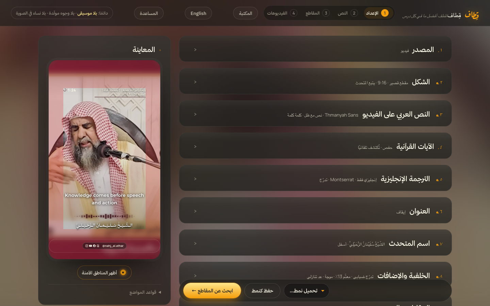
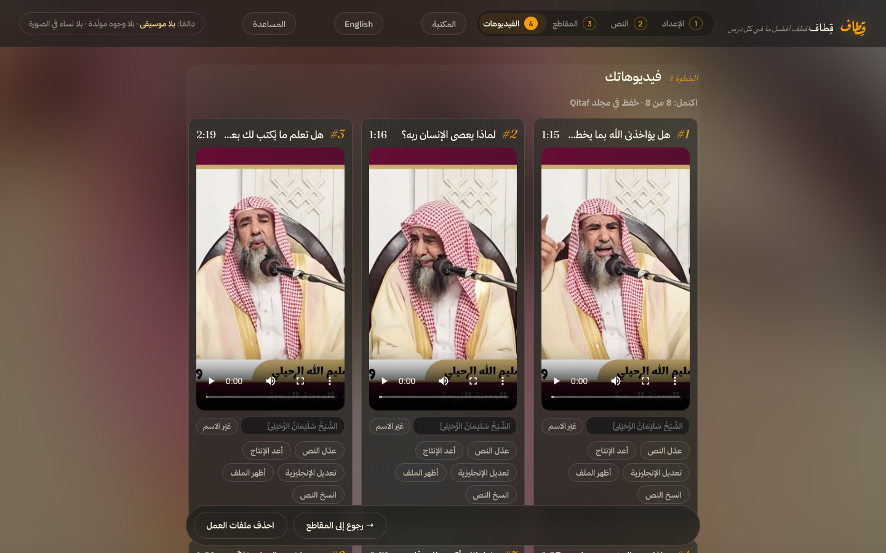
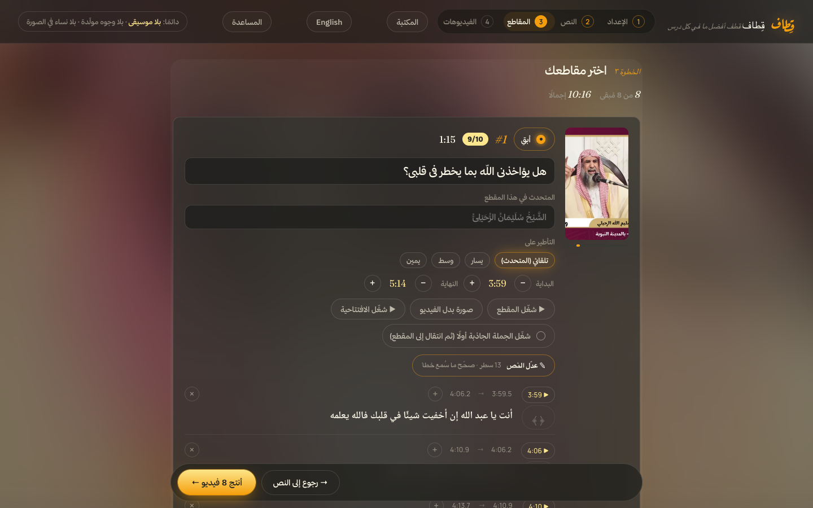
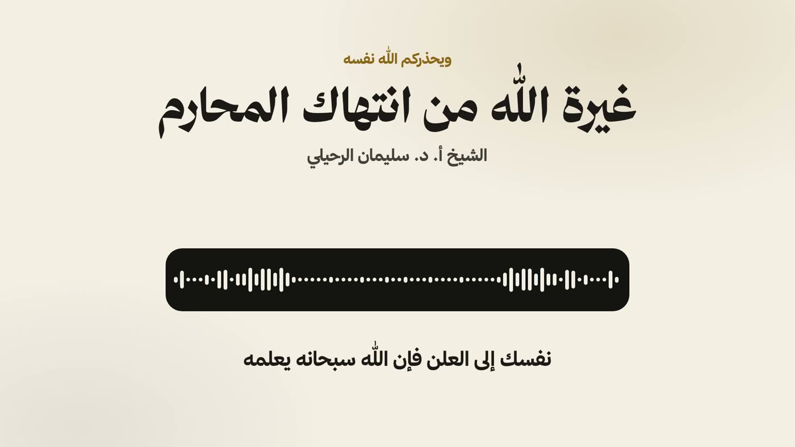
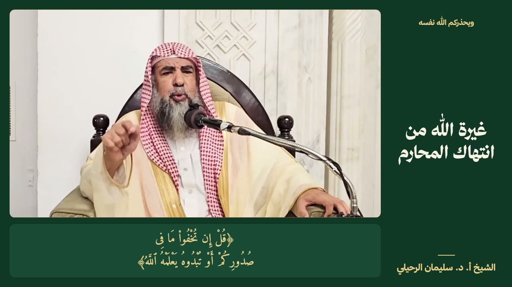
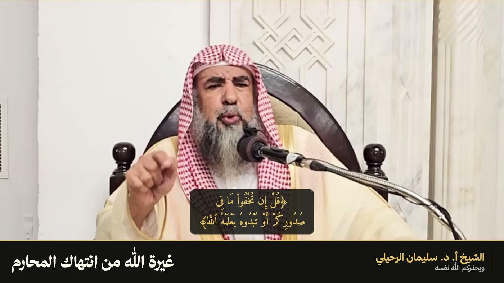

# قِطاف (Qitaf)

[English](README.md)

حوّل الدروس العربية إلى مقاطع قصيرة وفيديوهات يوتيوب طويلة، على جهازك أنت. ملفاتك تبقى عندك، والواجهة بالعربية والإنجليزية.

<table>
  <tr><th width="50%">فيديوهاتك الجاهزة</th><th width="50%">اختر مقاطعك</th></tr>
  <tr>
    <td width="50%"></td>
    <td width="50%"></td>
  </tr>
</table>

## ماذا يصنع

**المقاطع القصيرة:** أسقط درسًا طويلًا فيختار Claude أفضل اللحظات، أو استخدم فيديو قصيرًا واحدًا. يحذف قِطاف الصمت، ويتبع المتحدث، ويضيف النص موقّتًا مع الصوت، والآيات برسم المصحف، والعنوان والاسم والحسابات، والغلاف ونص المنشور.

**فيديوهات يوتيوب الطويلة:** درس كامل بأبعاد 16:9، مع ترجمة نصية، و٣ صور مصغرة، وعناوين، ووصف بفصول، وملف ترجمة. ولا يُقطع الكلام أبدًا.

<table>
  <tr><th width="33%">صوت فقط</th><th width="33%">لوحة</th><th width="33%">شريط عنوان</th></tr>
  <tr>
    <td></td>
    <td></td>
    <td></td>
  </tr>
</table>

## ماذا تحتاج

| | |
|---|---|
| الجهاز | ويندوز 10 أو 11، أو ماك بمعالج Apple Silicon (M1 أو أحدث). أجهزة ماك بمعالج Intel غير مدعومة. |
| Claude Code | مثبّت ومسجّل الدخول. يكتب العناوين ويختار المقاطع ويترجم، من اشتراكك أنت. |
| مساحة القرص | نحو 25 غيغابايت للتثبيت، وأكثر لدروسك |
| بطاقة الرسوميات | بطاقة NVIDIA تسرّع ويندوز كثيرًا، لكنها ليست شرطًا |
| الخطوط | غير مرفقة لأن تراخيصها لا تسمح بذلك. يعمل قِطاف بدونها، والصور هنا تستخدم [خط ثمانية](https://ask.thmanyah.com/hc/en-001/articles/45993930027281-Thmanyah-Font-for-Everyone) المجاني الذي تحصل عليه ببريدك. راجع `fonts/README.md`. |

## التثبيت

**الطريقة السهلة:** افتح Claude Code في المجلد الذي تريد وضع قِطاف فيه واكتب:

> Clone https://github.com/AbuGha1th/qitaf, open the folder, and follow CLAUDE.md to install Qitaf for me.

يثبّت Claude كل شيء، ويسألك عن النمط الذي تريده، ويرافقك في أول فيديو.

**يدويًا:**

1. في هذه الصفحة اضغط **Code ← Download ZIP**، ثم فك الضغط في مكان ستبقيه فيه.
2. شغّل التثبيت:
   - **ويندوز:** انقر مرتين على `Install Qitaf.bat`. إن ظهر تحذير، اختر **More info** ثم **Run anyway**.
   - **ماك:** انقر بالزر الأيمن على `Install Qitaf.command` ثم **Open**.
3. انتظر. يحمّل عدة غيغابايتات، وقد يستغرق هذا وقتًا.

عند الانتهاء يظهر اختصار **Qitaf** على سطح المكتب.

## الاستخدام

1. انقر مرتين على **Qitaf** في سطح المكتب، فيفتح المتصفح على http://localhost:8795.
2. أبقِ النافذة الصغيرة مفتوحة أثناء العمل، وأغلقها للإيقاف.
3. اضغط **المساعدة** أعلى الصفحة للدليل الكامل بالعربية والإنجليزية.

تُحفظ الفيديوهات النهائية في مجلد `Qitaf/clips` داخل مجلد المستخدم.

## تغيير النمط

ألوانك وخطوطك والموجة الصوتية وحساباتك كلها تُحفظ كأنماط داخل قِطاف. ولأي شيء آخر، افتح Claude Code في مجلد قِطاف واكتب ما تريد بكلماتك:

> غيّر تصميم الصورة المصغرة ليكون العنوان أكبر.

> أضفت خطًا إلى مجلد fonts، أضفه إلى قوائم الخطوط.

## التحديث

انقر مرتين على **Update Qitaf** في مجلد قِطاف. يحتاج هذا إلى نسخة مثبّتة عبر Git (الطريقة السهلة أعلاه). أنماطك وتصحيحاتك ودروسك وفيديوهاتك تبقى كما هي.

## عند حدوث مشكلة

افتح Claude Code في مجلد قِطاف والصق رسالة الخطأ، أو صف ما حدث. يستطيع قراءة `qitaf.log` وإصلاح أغلب المشكلات. وصفحة المساعدة تذكر المشكلات الشائعة.

## ما لا يفعله

- لا ينشر عنك
- بلا موسيقى، ولا وجوه مولّدة بالذكاء الاصطناعي، ولا نساء في الصورة
- النص الآلي قد يخطئ، فراجع الكلمات وكل آية قبل النشر

## الشكر

نص القرآن الكريم: رواية حفص من [Tanzil.net](https://tanzil.net)، ورواية ورش من [المصحف المحمدي الرقمي](https://app.al-mushaf.com/)، مؤسسة محمد السادس لنشر المصحف الشريف. إنتاج الفيديو عبر [HyperFrames](https://www.npmjs.com/package/hyperframes).

