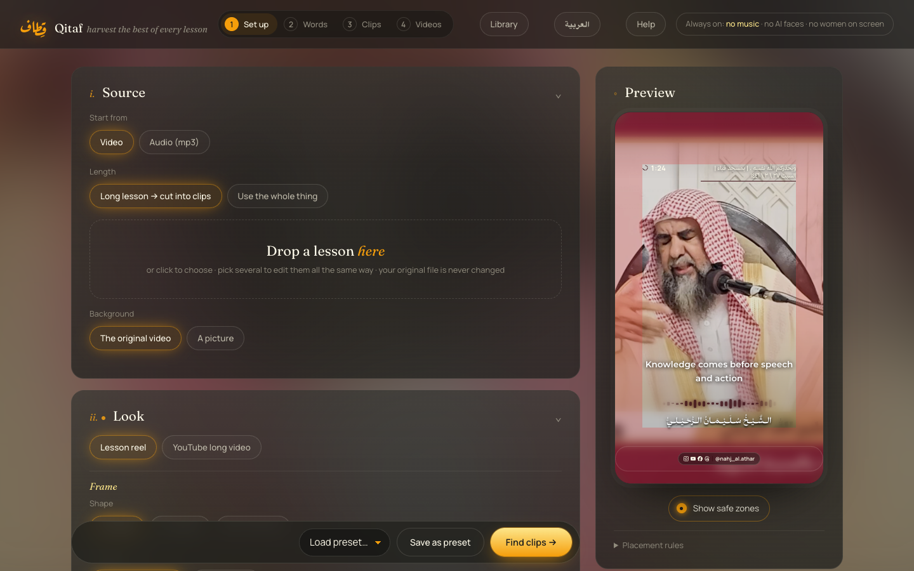
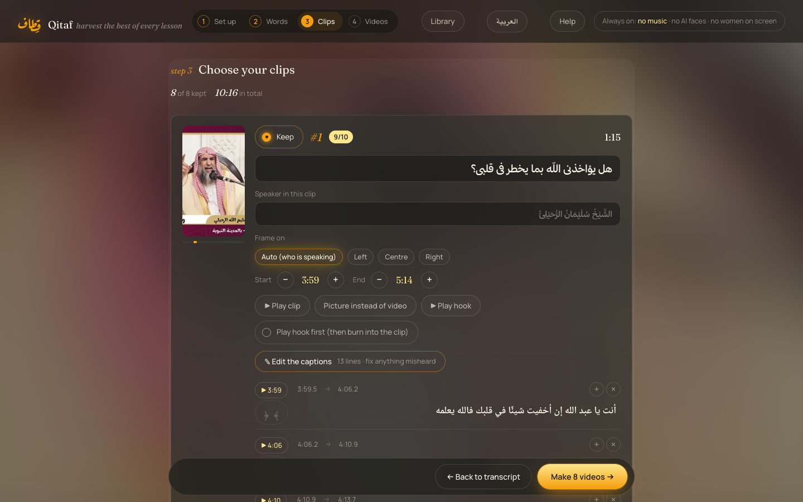
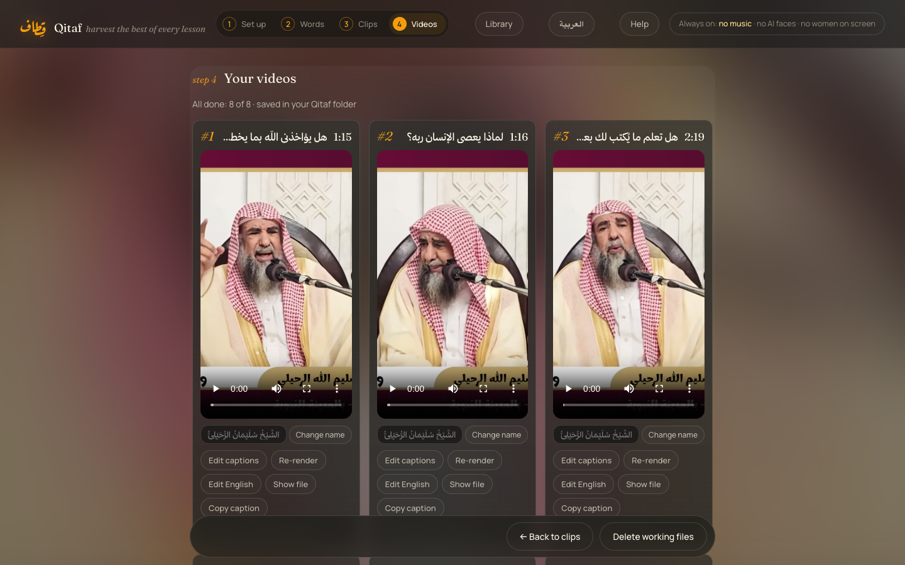
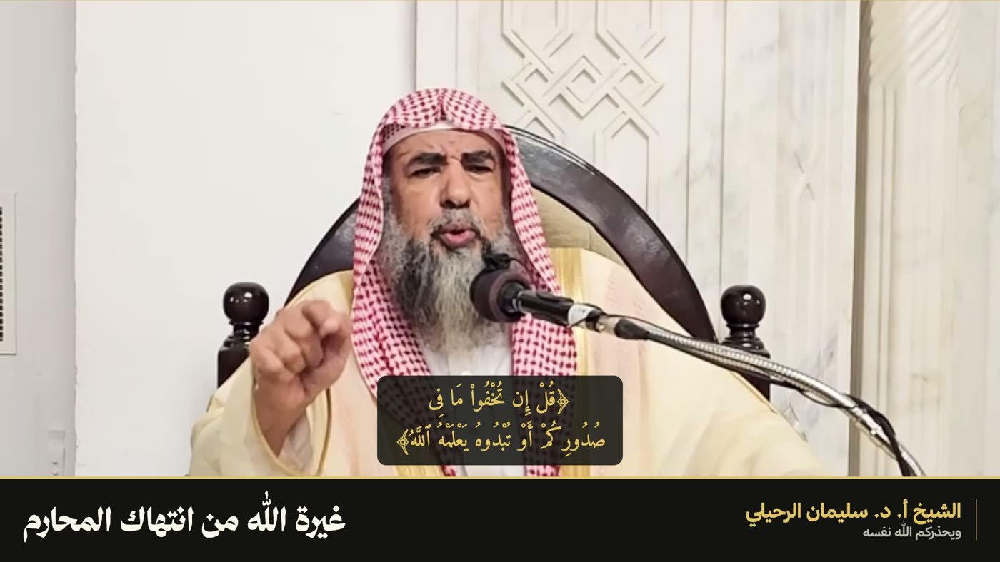
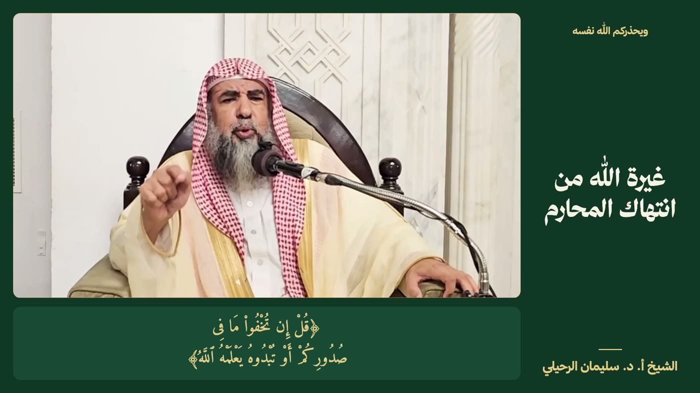
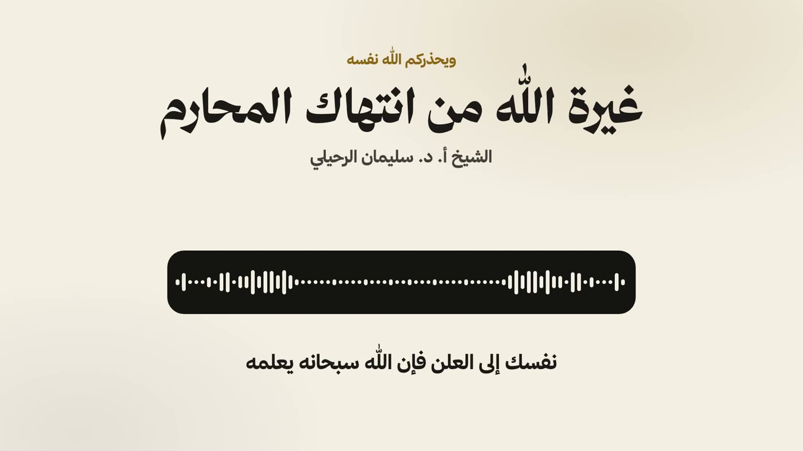

# Qitaf (قِطاف)

[العربية](README.ar.md)

Turn Arabic lessons into reels and long YouTube videos, on your own computer. Your files stay on your machine, and the interface is in Arabic and English.

<table>
  <tr><th width="50%">Choose your clips</th><th width="50%">Your finished videos</th></tr>
  <tr>
    <td width="50%"></td>
    <td width="50%"></td>
  </tr>
</table>

## What it makes

**Reels:** drop in a long lesson and Claude finds the best moments, or use one short video. Qitaf removes silences, follows the speaker, and adds timed captions, Qur'an verses in Mushaf text, your title, name and handles, a cover and the post text.

**Long YouTube videos:** a whole lesson in 16:9, with subtitles, 3 thumbnails, titles, a description with chapters, and a subtitle file. The speech is never cut.

<table>
  <tr><th width="33%">Title band</th><th width="33%">Board</th><th width="33%">Sound only</th></tr>
  <tr>
    <td></td>
    <td></td>
    <td></td>
  </tr>
</table>

## What you need

| | |
|---|---|
| Computer | Windows 10 or 11, or a Mac with Apple Silicon (M1 or newer). Intel Macs aren't supported. |
| Claude Code | Installed and signed in. It writes titles, picks clips and translates, using your own plan. |
| Disk space | About 25 GB for the install, and more for your lessons |
| Graphics | An NVIDIA card makes Windows much faster, but isn't required |
| Fonts | Not included, because their licences don't allow it. Qitaf works without them; the pictures here use the free [Thmanyah font](https://ask.thmanyah.com/hc/en-001/articles/45993930027281-Thmanyah-Font-for-Everyone), which you can get with your email. See `fonts/README.md`. |

## Install

**The easy way:** open Claude Code in the folder where you want Qitaf and say:

> Clone https://github.com/AbuGha1th/qitaf, open the folder, and follow CLAUDE.md to install Qitaf for me.

Claude installs everything, asks how you want your style, and walks you through your first video.

**By hand:**

1. On this page, click **Code → Download ZIP**, then unzip it somewhere you'll keep it.
2. Start the installer:
   - **Windows:** double-click `Install Qitaf.bat`. If Windows warns you, choose **More info → Run anyway**.
   - **Mac:** right-click `Install Qitaf.command` → **Open**.
3. Wait. It downloads several GB, so this can take a while.

When it finishes, a **Qitaf** shortcut is on your Desktop.

## Use it

1. Double-click **Qitaf** on your Desktop. Your browser opens at http://localhost:8795.
2. Keep the small window open while you work. Close it to stop.
3. Press **Help** at the top of the page for the full guide, in Arabic and English.

Finished videos are saved in the `Qitaf/clips` folder in your user folder.

## Change the style

Your colours, fonts, sound wave and handles are all saved as presets inside Qitaf. For anything else, open Claude Code in the Qitaf folder and describe what you want:

> Change the thumbnail design so the title is bigger.

> I added a font to the fonts folder. Add it to the font lists.

## Update

Double-click **Update Qitaf** in the Qitaf folder. This needs a copy installed with Git (the Claude way above). Your presets, word fixes, lessons and videos are kept.

## If something goes wrong

Open Claude Code in the Qitaf folder and paste the error, or say what happened. It can read `qitaf.log` and fix most problems. The Help page lists the common ones.

## What it doesn't do

- It doesn't publish for you
- No music, no AI-generated faces, no women on screen
- Automatic transcription makes mistakes, so check the words and every Qur'an verse before publishing

## Credits

Qur'an text: Hafs from [Tanzil.net](https://tanzil.net), Warsh from the Mohammed VI Foundation's [digital Mushaf](https://app.al-mushaf.com/). Video rendering by [HyperFrames](https://www.npmjs.com/package/hyperframes).
